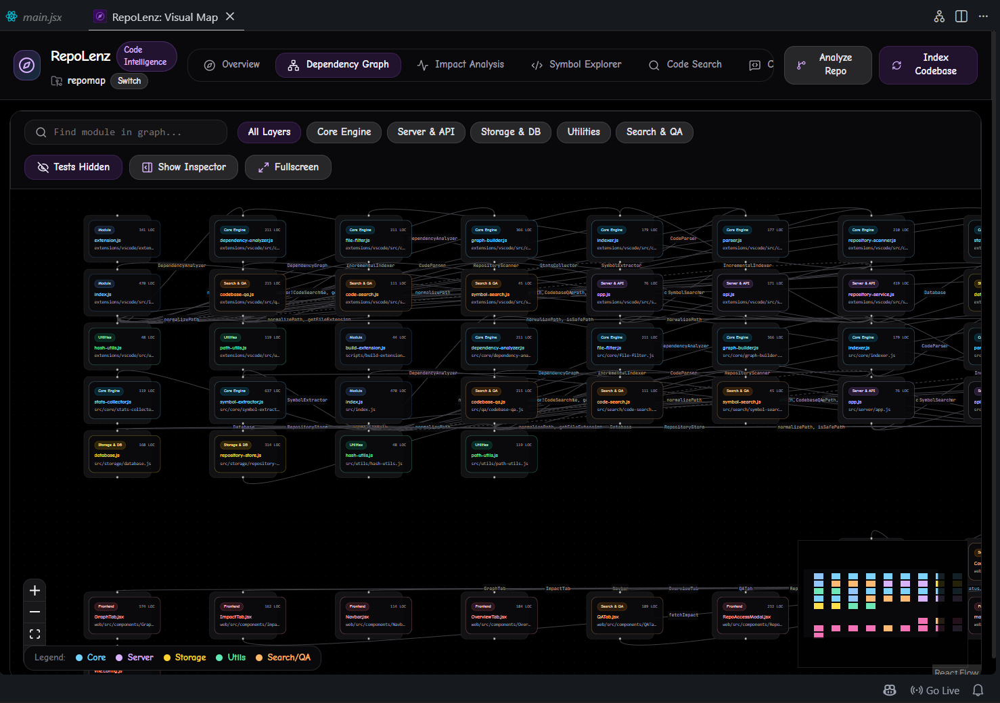
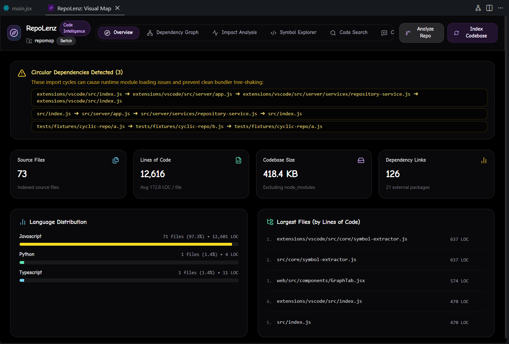
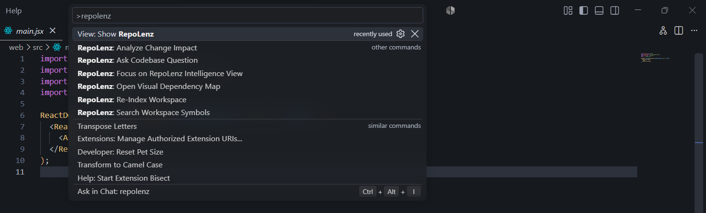
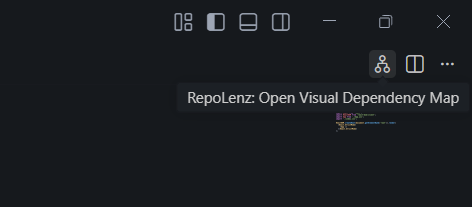

# RepoLenz for Visual Studio Code

<p align="center">
  
</p>

<p align="center">
  <strong>Interactive Codebase Dependency Graphs & Change Impact Blast Radius Analysis</strong><br>
  Explore module connections, detect circular dependencies, and prevent breaking changes directly inside VS Code.
</p>

<p align="center">
  
  
  
</p>

---

## 📸 Screenshots

### 1. Interactive Dependency Graph in Editor Tab
Pan, zoom, and inspect full module architecture directly within your editor.



---

### 2. Architecture Overview & Circular Dependency Check
Detect problematic import cycles before they break bundling, and review lines-of-code and file metrics.



---

### 3. Quick Access via Editor Title Bar & Command Palette
Launch the map in one click using the editor header button or execute dedicated commands from the Command Palette (`Ctrl+Shift+P` / `Cmd+Shift+P`).

<p align="center">
  
  &nbsp;&nbsp;
  
</p>

---

## ⚡ Key Features

- 🗺️ **Interactive Visual Graph**: Powered by React Flow with custom AST-derived layers (Core Engine, Server, Storage, Utilities, Search).
- ⚡ **Change Impact Analysis (Blast Radius)**: Right-click any file to see exactly which downstream modules and imports depend on it.
- 🔗 **Bidirectional Navigation**: Click any module node or file in RepoLenz to jump directly to that file and line in an adjacent editor tab.
- 🔁 **Circular Dependency Detection**: Identifies import cycles (DAG validation) to prevent runtime initialization loops and bundler bloat.
- 🔍 **Symbol Explorer**: Search functions, classes, and exported interfaces across your entire workspace.
- 💬 **Codebase Q&A**: Get deterministic answers with direct file and line citations.
- 🛡️ **100% Offline & Private**: Runs entirely on your local machine using an in-process ephemeral loopback server. Zero data or telemetry ever leaves your computer.

---

## 🚀 How to Use

### 1. Launch the Visual Dependency Map
- **Editor Title Button**: Click the `$(type-hierarchy)` icon in the top-right corner of any open code file.
- **Activity Bar**: Click the **RepoLenz** compass icon in the left Activity Bar and select **Open Visual Dependency Map**.
- **Command Palette**: Press `Ctrl+Shift+P` (or `Cmd+Shift+P` on macOS) → type **`RepoLenz: Open Visual Dependency Map`**.

### 2. Analyze Change Impact for a Specific File
- **In File Explorer**: Right-click any file in your project tree → click **"RepoLenz: Analyze Change Impact"**.
- **In Editor**: Right-click inside your active code editor → click **"RepoLenz: Analyze Change Impact"**.
- RepoLenz opens directly on the **Impact Analysis** tab with that file selected!

### 3. Search Symbols & Architecture
- Run **`RepoLenz: Search Workspace Symbols`** to jump to the Symbol Explorer.
- Run **`RepoLenz: Ask Codebase Question`** to ask questions grounded in your repository's AST.
- Run **`RepoLenz: Re-Index Workspace`** to refresh dependencies after creating new files or branches.

---

## ⌨️ Contributed Commands

| Command | Title | Description |
| :--- | :--- | :--- |
| `repolenz.open` | **RepoLenz: Open Visual Dependency Map** | Opens the interactive graph dashboard |
| `repolenz.analyzeActiveFile` | **RepoLenz: Analyze Change Impact** | Traces downstream blast radius of active file |
| `repolenz.searchSymbols` | **RepoLenz: Search Workspace Symbols** | Navigates symbols, functions, and classes |
| `repolenz.askQA` | **RepoLenz: Ask Codebase Question** | Architecture Q&A grounded in source files |
| `repolenz.reindex` | **RepoLenz: Re-Index Workspace** | Manually refreshes the SQLite AST cache |

---

## 📦 Packaging & Local Installation

To build and package this extension manually from source:

```bash
# From repository root:
npm run build:extension

# Package extension:
cd extensions/vscode
npm install --omit=dev
npx @vscode/vsce package
```

To install the resulting `.vsix`:
```bash
code --install-extension repolenz-0.1.0.vsix
```

---

## 🌐 Publishing to VS Code Marketplace

1. Generate a **Personal Access Token (PAT)** at [dev.azure.com](https://dev.azure.com) with **Marketplace (Acquire, Manage, Publish)** scope.
2. Register your publisher at [marketplace.visualstudio.com/manage](https://marketplace.visualstudio.com/manage).
3. Publish from terminal:
   ```bash
   cd extensions/vscode
   npx @vscode/vsce publish
   ```
   *Or upload `repolenz-0.1.0.vsix` directly through the web portal.*

---

## 📄 License

MIT © [RepoLenz](https://github.com/repolenz/repolenz)
